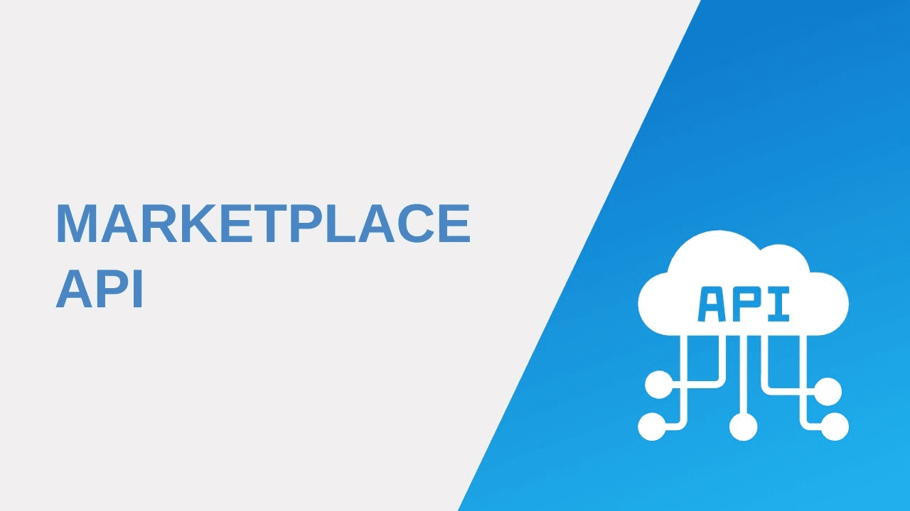

# 🛒 Marketplace API

Асинхронный REST API бэкенд для маркетплейса, построенный на современной FastAPI архитектуре. 
Проект реализует полный цикл работы e-commerce платформы: управление пользователями, магазинами, категориями и товарами, а также загрузку файлов и ролевую модель доступа (RBAC).

## 🚀 Стек технологий

- **Фреймворк:** FastAPI
- **База данных:** PostgreSQL + `asyncpg`
- **ORM & Миграции:** SQLAlchemy 2.0 + Alembic
- **Аутентификация:** JWT (JSON Web Tokens) + OAuth2 с хэшированием паролей (`pwdlib`)
- **Архитектура:** Clean Architecture (Router -> Service -> DAO) + Generic Repository (`BaseDAO`)
- **Тестирование:** Pytest + `aiosqlite` (in-memory BD)
- **Контейнеризация:** Docker + Docker Compose
- **CI/CD:** Настроенный пайплайн тестирования

## ⚙️ Быстрый старт (через Docker)

Проект полностью упакован в Docker. Для запуска на любой машине потребуется только `docker` и `docker-compose`.

**1. Клонируйте репозиторий:**
```bash
git clone https://github.com/Jem-Male/marketplace-api.git
cd marketplace-api
```

**2. Настройте переменные окружения:**
Создайте файл `.env` в корне проекта (можете скопировать из `.env.example`):
```env
DATABASE_USER=postgres
DATABASE_PASSWORD=your_password
DATABASE_NAME=marketplace
DATABASE_HOST=db
DATABASE_PORT=5432
SECRET_KEY=your_super_secret_key_minimum_32_chars
ALGORITHM=HS256
ACCESS_TOKEN_EXPIRE_HOURS=24
```

**3. Запустите проект:**
```bash
docker-compose up -d --build
```
*(При запуске Docker автоматически накатит все миграции Alembic на базу данных).*

**4. Откройте документацию:**
Перейдите в браузере по адресу: [http://localhost:8000/docs](http://localhost:8000/docs)
Здесь доступен интерактивный Swagger UI, через который можно тестировать API.

## 🛡 Архитектура и безопасность

- **Generic Repository (BaseDAO):** Позволил избавиться от дублирования кода при работе с БД.
- **RBAC (Role-Based Access Control):** 4 уровня доступа (`Customer`, `Manager`, `Owner`, `Admin`). Действия жестко разграничены (например, удалять чужие магазины может только Admin с вводом пароля — *Sudo Mode*).
- **Безопасная загрузка файлов:** Изолированное хранилище, защита от Path Traversal, автоматический Garbage Collection при обновлении аватарок.
- **Изолированные тесты:** Pytest запускает тесты в отдельной in-memory базе SQLite, не загрязняя боевую БД.

## 🧪 Запуск тестов (Локально)

Для запуска интеграционных тестов вне Докера (через in-memory БД SQLite):
```bash
pip install -r requirements.txt
python -m pytest -v -s
```